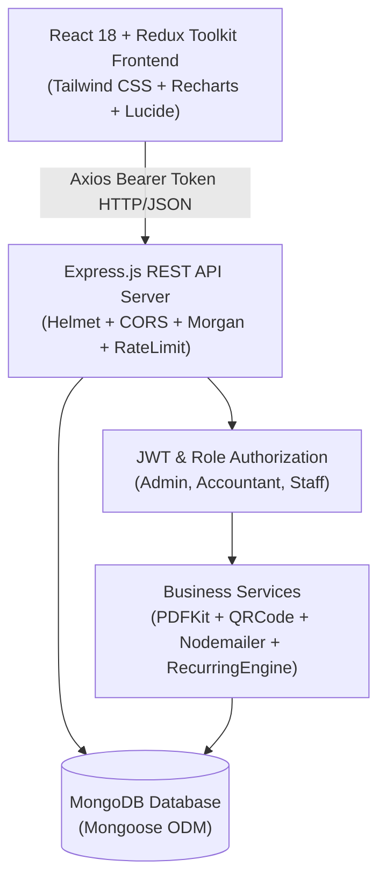

# NexusBill — Enterprise MERN Billing & Invoice Management System


NexusBill is a production-grade, full-stack enterprise web application designed for comprehensive client billing, invoicing, payments tracking, inventory management, and business intelligence analytics. Built following modern software architectural principles, modular clean code, responsive mobile-first UI, and enterprise-grade security.

---

## 🌟 Key Application Features

### 1. Authentication & Role-Based Access Control (RBAC)
- **Role Hierarchy**:
  - `Admin`: Full system control, user access management, system settings, financial deletions, and immutable audit logs.
  - `Accountant`: Manages invoices, records client payments, issues receipts, manages products and categories, views financial reports.
  - `Staff`: Drafts invoices, reviews customer records, views product catalogs with restricted modification permissions.
- **Security Features**:
  - Encrypted passwords using `bcryptjs` with salt rounds.
  - Stateless JWT authentication with Bearer token header interceptors.
  - Secure cryptographic password reset tokens sent via email with 1-hour expiration.
  - Brute-force rate limiting protection (`express-rate-limit`) on authentication endpoints.

### 2. Executive Financial Dashboard
- **Real-Time KPIs**:
  - Total Revenue Collected
  - Active Client Accounts
  - Total Invoices Generated
  - Fully Paid Invoices (Count & Gross Amount)
  - Pending / Sent Invoices (Count & Gross Amount)
  - Overdue Invoices (Count & Overdue Balance Due)
- **Interactive Visualizations**:
  - **Revenue Analytics Trend** (Recharts Area Chart) displaying collections and transactions over rolling monthly periods.
  - **Invoice Status Distribution** (Recharts Donut Chart) highlighting Paid, Pending, Partially Paid, Overdue, and Draft distributions.
- **Quick Action Bar**: Shortcuts to generate invoices, register clients, add catalog items, or record payments.
- **Live Activity Streams**: Recent payments receipts table and recent invoices feed.

### 3. Client & Customer Relationship Management
- Full CRUD operations with instant search by name, company, email, or phone.
- Customer profile pages displaying:
  - Total billed volume, total paid, and outstanding balance KPIs.
  - Complete billing and invoice history.
  - Settlement records and transaction receipts.
  - Primary billing and shipping addresses.
  - Client tax ID / GST / VAT registration tracking.

### 4. Product, Service & Inventory Management
- Support for both physical goods and intangible services/consulting.
- SKU tracking, unit definitions (`pcs`, `hrs`, `units`, `projects`, `months`), cost price, selling price, and tax rates.
- Dynamic inventory stock tracking with automatic quantity deduction on invoice creation.
- Real-time **Low Stock Alerts** with notification badges when physical items drop below thresholds.
- Category classification system.

### 5. Advanced Invoicing Engine
- Sequential invoice numbering generator (`{PREFIX}-{YEAR}-{SEQUENCE}`, e.g., `INV-2026-0001`).
- Real-time client-side and server-side calculation of:
  - Subtotal
  - Percentage or fixed discount deductions
  - Itemized or flat tax rates (GST/VAT)
  - Shipping & freight fees
  - Grand total
  - Total payments applied and balance due
- Auto-status lifecycle (`Draft` ➔ `Sent` ➔ `Partially Paid` ➔ `Paid` / `Overdue`).
- Automatic background overdue detection.
- **Recurring Invoices & Subscription Billing Engine**: Automatic generation of scheduled weekly, monthly, quarterly, or yearly billing cycles.

### 6. PDF Generation & QR Codes
- **Server-Side PDF Streaming**: High-resolution vector PDF generation using `pdfkit` streamed directly as downloadable attachments.
- **Client-Side PDF Export**: Instant canvas-based PDF generation via `jspdf` and `html2canvas`.
- **Clean Print Styling**: Print-optimized layout hiding navigation sidebars, headers, and UI chrome.
- **QR Code Verification**: High-density QR code rendered on every invoice encoding invoice number, customer name, grand total, and payment verification data.

### 7. Payment Tracking & Settlement Receipts
- Record full or partial payments across various payment methods (Bank Wire, Credit Card, UPI, PayPal, Stripe, Cash, Cheque).
- Automatic sequential receipt numbering (`REC-YYYY-XXXXX`).
- Automatic balance due calculation and status transition to `Partially Paid` or `Paid`.
- Automatic synchronization with customer aggregate account balances.

### 8. Analytics & Report Center
- Customer spending performance ranking (Top revenue contributors).
- Product & service volume breakdown (Units sold and gross revenue generated).
- Payment method settlement distribution.
- **Excel (.xlsx) Export**: One-click spreadsheet export for invoices, customer directories, product catalogs, and transaction receipts using `xlsx`.

### 9. Notifications & Audit Logs
- Global notification center for overdue alerts, payments received, invoice dispatches, and low stock warnings.
- Immutable **Compliance Audit Trail** recording who performed what action, entity ID, description, client IP address, and timestamp.

### 10. Modern Responsive UX
- Clean Tailwind CSS design.
- **Dark & Light Mode** with automatic system preference detection and `localStorage` persistence.
- Mobile drawer navigation and collapsible desktop sidebar.
- Form validations with user-friendly error banners.

---

## 🏗️ System Architecture



---

## 📁 Project Directory Structure

```text
WEB-APPLICATION/
├── client/
│   ├── public/
│   ├── src/
│   │   ├── components/
│   │   │   ├── common/             # StatCard, Badge, Modal, ConfirmModal, LoadingSpinner, EmptyState, Navbar, Sidebar
│   │   │   ├── dashboard/          # RevenueAnalyticsChart, InvoiceStatusPieChart, RecentTransactionsTable, QuickActions
│   │   │   ├── invoices/           # InvoiceForm, InvoicePreviewModal, PaymentRecordModal, SendEmailModal
│   │   │   ├── customers/          # CustomerModal
│   │   │   └── products/           # ProductModal, CategoryModal
│   │   ├── hooks/                  # useAuth, useTheme, useCurrency
│   │   ├── layouts/                # DashboardLayout, AuthLayout
│   │   ├── pages/
│   │   │   ├── auth/               # Login, Register, ForgotPassword, ResetPassword
│   │   │   ├── dashboard/          # Dashboard
│   │   │   ├── invoices/           # InvoiceList, InvoiceCreate, InvoiceEdit, InvoiceDetail
│   │   │   ├── customers/          # CustomerList, CustomerDetail
│   │   │   ├── products/           # ProductList
│   │   │   ├── payments/           # PaymentList
│   │   │   ├── reports/            # ReportsAnalytics
│   │   │   ├── settings/           # Settings, AuditLogs
│   │   │   └── NotFound.jsx
│   │   ├── redux/
│   │   │   ├── slices/             # authSlice, invoiceSlice, customerSlice, productSlice, paymentSlice, reportSlice, etc.
│   │   │   └── store.js
│   │   ├── routes/                 # AppRoutes, ProtectedRoute
│   │   ├── services/               # api.js (Axios instance with JWT interceptors)
│   │   ├── utils/                  # formatters.js, excelExport.js, pdfExport.js
│   │   ├── App.jsx
│   │   ├── index.css               # Tailwind base & print rules
│   │   └── main.jsx
│   ├── index.html
│   ├── tailwind.config.js
│   ├── vite.config.js
│   ├── package.json
│   └── .env.example
├── server/
│   ├── config/                     # db.js (MongoDB connection with in-memory fallback)
│   ├── controllers/                # auth, customer, product, invoice, payment, report, notification, setting
│   ├── middleware/                 # authMiddleware, roleMiddleware, errorMiddleware, loggingMiddleware, rateLimitMiddleware
│   ├── models/                     # User, Customer, Product, Category, Invoice, Payment, Notification, Setting, AuditLog
│   ├── routes/                     # Modular Express routers
│   ├── seeder/                     # seedData.js (Realistic seed dataset generator)
│   ├── services/                   # pdfService, qrService, emailService, recurringInvoiceService
│   ├── utils/                      # generateInvoiceNumber, logger, sendEmail
│   ├── validations/                # Joi validation schemas
│   ├── server.js                   # Application entry point
│   ├── package.json
│   └── .env.example
├── package.json                    # Root scripts
└── README.md
```

---

## ⚡ Quick Start & Local Execution

### Prerequisites
- **Node.js**: v18.0.0 or higher (`node -v`)
- **NPM**: v9.0.0 or higher (`npm -v`)
- **MongoDB**: Local MongoDB instance OR MongoDB Atlas cluster URI (An automatic in-memory MongoDB engine is bundled for immediate zero-config testing if no external database is supplied).

### 1. Installation
Install server and client packages from the project root:
```bash
# In server directory:
cd server
npm install

# In client directory:
cd ../client
npm install
```

### 2. Environment Configuration
Create `.env` inside `server/`:
```env
PORT=5000
NODE_ENV=development
MONGO_URI=memory
JWT_SECRET=super_secret_jwt_key_billing_2026_change_in_production
JWT_EXPIRE=7d
CLIENT_URL=http://localhost:5173
FROM_EMAIL=no-reply@nexusbill.com
FROM_NAME="Nexus Billing Solutions"
```
*(To use MongoDB Atlas, change `MONGO_URI` to your `mongodb+srv://...` string)*

Create `.env` inside `client/`:
```env
VITE_API_BASE_URL=/api
```

### 3. Seed Database with Demo Accounts
Run the seed script in `server/` to generate sample users, categories, products, customers, invoices, and payments:
```bash
cd server
npm run seed
```

### 4. Run the Development Servers
**Terminal 1 — Backend API Server:**
```bash
cd server
npm run dev
# Running on http://localhost:5000
```

**Terminal 2 — Frontend Application:**
```bash
cd client
npm run dev
# Running on http://localhost:5173
```

---

## 🔑 Pre-Seeded Demo Credentials

| Role | Email | Password | Access Level |
| :--- | :--- | :--- | :--- |
| **Admin** | `admin@nexusbill.com` | `password123` | Full access: User management, Audit logs, System Settings, Full CRUD |
| **Accountant** | `accountant@nexusbill.com` | `password123` | Invoices, Payments, Customers, Products, Financial Reports |
| **Staff** | `staff@nexusbill.com` | `password123` | Invoices Creation, Customer Directory, Catalog Viewing |

*Note: The login page includes quick 1-click demo login buttons for each role.*

---

## 📡 RESTful API Documentation

### Authentication (`/api/auth`)
| Method | Endpoint | Access | Description |
| :--- | :--- | :--- | :--- |
| `POST` | `/api/auth/register` | Public | Register new user workspace |
| `POST` | `/api/auth/login` | Public | Authenticate user & return JWT token |
| `GET` | `/api/auth/me` | Private | Retrieve current user profile |
| `PUT` | `/api/auth/profile` | Private | Update user details & company profile |
| `POST` | `/api/auth/forgotpassword` | Public | Request cryptographic password reset link |
| `PUT` | `/api/auth/resetpassword/:token`| Public | Reset password using one-time token |
| `GET` | `/api/auth/users` | Admin | List all system accounts |
| `PUT` | `/api/auth/users/:id` | Admin | Modify user role or account status |

### Invoices (`/api/invoices`)
| Method | Endpoint | Access | Description |
| :--- | :--- | :--- | :--- |
| `GET` | `/api/invoices` | Private | List invoices with search, date & status filters, and pagination |
| `POST` | `/api/invoices` | Private | Create invoice (auto-generates invoice #, QR code, recalculates stock) |
| `GET` | `/api/invoices/:id` | Private | Get single invoice details and attached payment records |
| `PUT` | `/api/invoices/:id` | Private | Update invoice details, lines, and recalculate balance |
| `DELETE`| `/api/invoices/:id` | Accountant/Admin | Delete invoice (prevented if payments are recorded) |
| `GET` | `/api/invoices/:id/pdf` | Private | Generate & stream official PDFKit invoice document |
| `POST` | `/api/invoices/:id/send`| Private | Email invoice directly to client with PDF attachment |
| `POST` | `/api/invoices/process-recurring`| Accountant/Admin | Trigger recurring subscription invoices execution |

### Customers (`/api/customers`)
| Method | Endpoint | Access | Description |
| :--- | :--- | :--- | :--- |
| `GET` | `/api/customers` | Private | List customers with search, status filters, and pagination |
| `POST` | `/api/customers` | Private | Create client record |
| `GET` | `/api/customers/:id` | Private | Single customer profile with invoice & payment histories |
| `PUT` | `/api/customers/:id` | Private | Update client contact, address, or tax ID |
| `DELETE`| `/api/customers/:id` | Accountant/Admin | Delete customer (prevented if outstanding balance exists) |

### Products & Services (`/api/products`)
| Method | Endpoint | Access | Description |
| :--- | :--- | :--- | :--- |
| `GET` | `/api/products` | Private | List products/services with SKU, category, and low stock filters |
| `POST` | `/api/products` | Accountant/Admin | Create product or service offering |
| `GET` | `/api/products/:id` | Private | Get product details |
| `PUT` | `/api/products/:id` | Accountant/Admin | Update product price, tax rate, or inventory quantity |
| `DELETE`| `/api/products/:id` | Accountant/Admin | Delete product |
| `GET` | `/api/products/categories/all` | Private | List all product categories |
| `POST` | `/api/products/categories` | Accountant/Admin | Create new category |

### Payments (`/api/payments`)
| Method | Endpoint | Access | Description |
| :--- | :--- | :--- | :--- |
| `GET` | `/api/payments` | Private | List payments with customer, method, and date filters |
| `POST` | `/api/payments` | Accountant/Admin | Record payment against invoice (auto-updates balances & receipts) |
| `GET` | `/api/payments/:id` | Private | View specific payment receipt |

### Reports & Analytics (`/api/reports`)
| Method | Endpoint | Access | Description |
| :--- | :--- | :--- | :--- |
| `GET` | `/api/reports/dashboard`| Private | Retrieve KPI cards, monthly revenue trend, and recent items |
| `GET` | `/api/reports/analytics`| Private | Customer spending analysis, product sales volume, and payment methods |

### Settings & Audits (`/api/settings`)
| Method | Endpoint | Access | Description |
| :--- | :--- | :--- | :--- |
| `GET` | `/api/settings` | Private | Get system settings, company profile, and currency format |
| `PUT` | `/api/settings` | Admin | Update system preferences, email SMTP, and invoice template terms |
| `GET` | `/api/settings/audit-logs` | Admin | Searchable audit trail logs with timestamps and IP addresses |

---

## 🚀 Production Deployment Guide

### Architecture: MongoDB Atlas + Render (Backend) + Vercel (Frontend)

```text
[ Vercel CDN ]  ────►  [ Render Web Service ]  ────►  [ MongoDB Atlas ]
(Frontend SPA)         (Node.js Express API)          (Cloud Database Cluster)
```

### 1. Database Setup: MongoDB Atlas
1. Sign in to [MongoDB Atlas](https://www.mongodb.com/cloud/atlas).
2. Create a free **M0 Shared Cluster**.
3. Under **Database Access**, create a database user (e.g., `nexus_admin`) with password.
4. Under **Network Access**, add IP `0.0.0.0/0` (Allow access from anywhere).
5. In your cluster dashboard, click **Connect** ➔ **Drivers** (Node.js) ➔ Copy the connection string:
   ```text
   mongodb+srv://nexus_admin:<password>@cluster0.abcde.mongodb.net/nexus_billing?retryWrites=true&w=majority
   ```

### 2. Backend Deployment: Render
1. Push the codebase to your GitHub repository.
2. Sign in to [Render](https://render.com) and click **New +** ➔ **Web Service**.
3. Connect your GitHub repository.
4. Configure service parameters:
   - **Root Directory**: `server`
   - **Environment**: `Node`
   - **Build Command**: `npm install`
   - **Start Command**: `npm start`
5. In **Environment Variables**, define:
   - `NODE_ENV`: `production`
   - `PORT`: `10000`
   - `MONGO_URI`: *Your MongoDB Atlas connection URI*
   - `JWT_SECRET`: *A secure 64-character random string*
   - `JWT_EXPIRE`: `7d`
   - `CLIENT_URL`: *Your Vercel domain (e.g. `https://nexusbill.vercel.app`)*
6. Click **Deploy Web Service**. Once built, copy your Render URL (e.g., `https://nexus-billing-api.onrender.com`).

### 3. Frontend Deployment: Vercel
1. Sign in to [Vercel](https://vercel.com) and click **Add New** ➔ **Project**.
2. Select your GitHub repository.
3. Configure project settings:
   - **Framework Preset**: `Vite`
   - **Root Directory**: `client`
   - **Build Command**: `npm run build`
   - **Output Directory**: `dist`
4. In **Environment Variables**, configure:
   - `VITE_API_BASE_URL`: `https://nexus-billing-api.onrender.com/api`
5. Click **Deploy**. Vercel will build the frontend assets and distribute them globally over edge CDN nodes.

### 4. SPA Routing on Vercel
Create `client/vercel.json` to handle client-side routing rewrites:
```json
{
  "rewrites": [
    {
      "source": "/(.*)",
      "destination": "/index.html"
    }
  ]
}
```

---

## 🛡️ Security Best Practices Implemented
- **Helmet**: Secures HTTP headers against XSS, clickjacking, and MIME-sniffing.
- **CORS Allowlist**: Restricts cross-origin requests to configured client domains.
- **Rate Limiting**: Defends authentication endpoints against brute force credential stuffing.
- **Joi Validations**: Strict schema validation preventing injection of arbitrary object payloads.
- **Password Salting**: Strong irreversible one-way hashing with bcrypt.
- **Audit Logging**: Immutable tracking of financial events and administrative updates.

---

## 📄 License
This project is licensed under the MIT License - open for personal, commercial, and enterprise usage.
